# 🏎️ HYPERCAR-X: Parametric Electric Hypercar

[](https://github.com/jaineil32624/hypercar-x/actions/workflows/simulate.yml)
[](https://github.com/jaineil32624/hypercar-x/actions/workflows/build-apps.yml)

| 🌐 Website | 🏁 Drive in browser | 📱 Android APK | 🖥️ Windows | 📊 Presentation |
|---|---|---|---|---|
| [jaineil32624.github.io/hypercar-x](https://jaineil32624.github.io/hypercar-x/) | [drive.html](https://jaineil32624.github.io/hypercar-x/drive.html) | [hypercar-x.apk](https://github.com/jaineil32624/hypercar-x/releases/latest/download/hypercar-x.apk) | [HypercarX-windows.zip](https://github.com/jaineil32624/hypercar-x/releases/latest/download/HypercarX-windows.zip) | [presentation.html](https://jaineil32624.github.io/hypercar-x/presentation.html) |

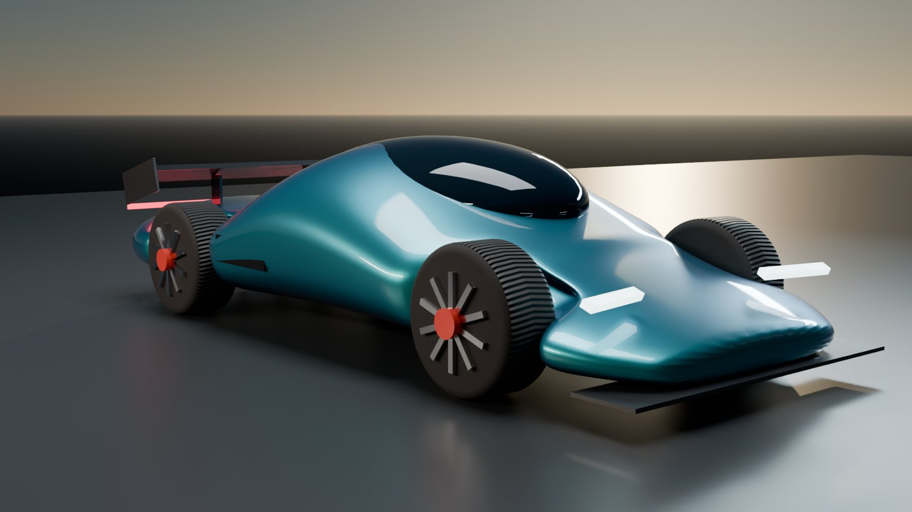

| | | |
|---|---|---|
| 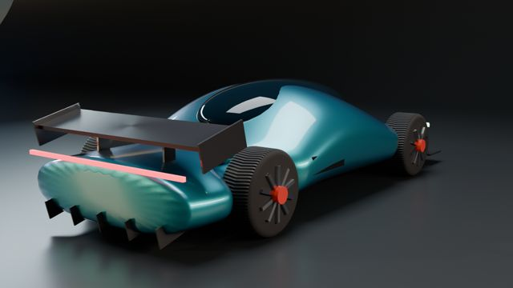 | 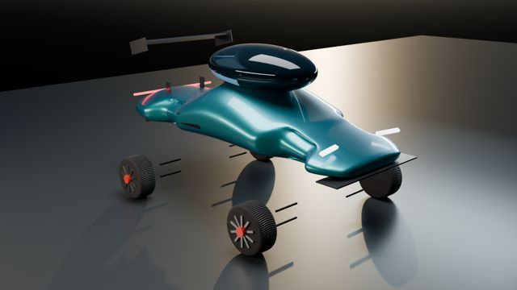 | 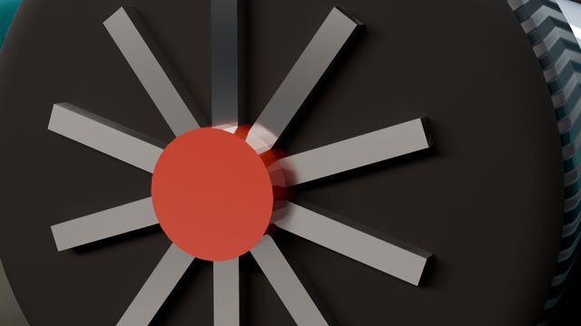 |
| 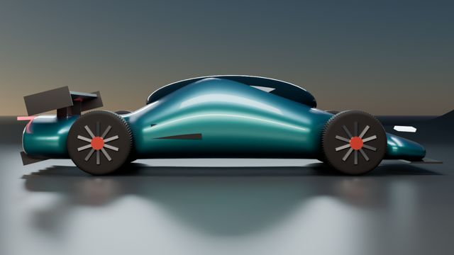 | 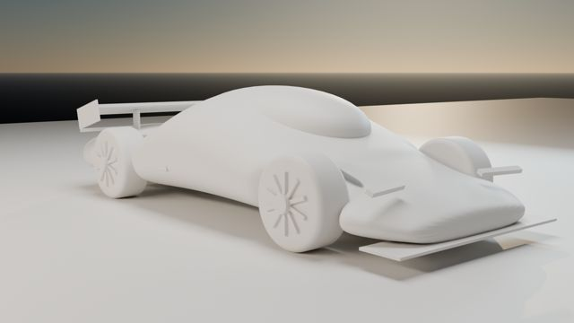 | 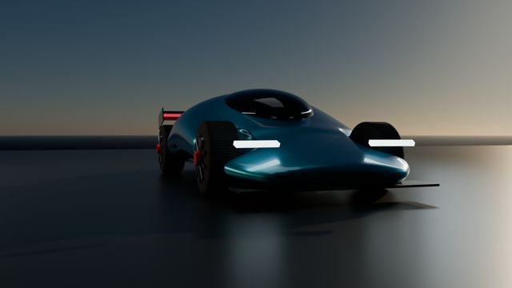 |
| 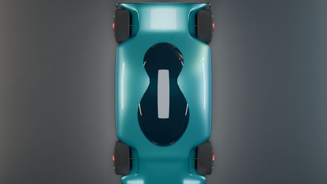 | 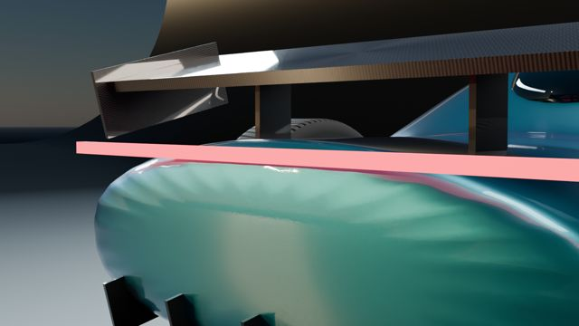 | 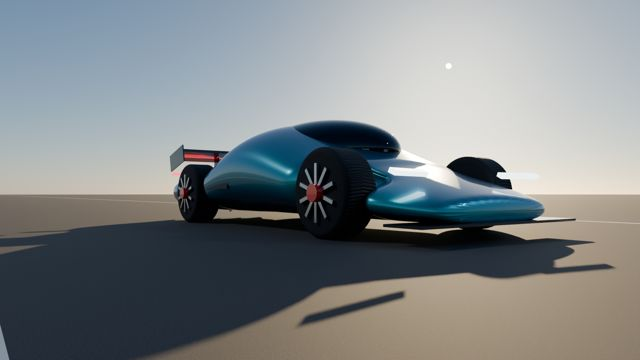 |

A concept-level vehicle engineering package where **one master parameter table (`params.json`) drives everything**: mass and CG, aerodynamics, launch and braking simulation, suspension, steering, chassis FEA, range, reliability and cost. On top of that sit a **rigged, textured Blender model**, a **drivable browser simulator** and a **Godot 4 app for Android and Windows**.

## Godot app (`godot/`)
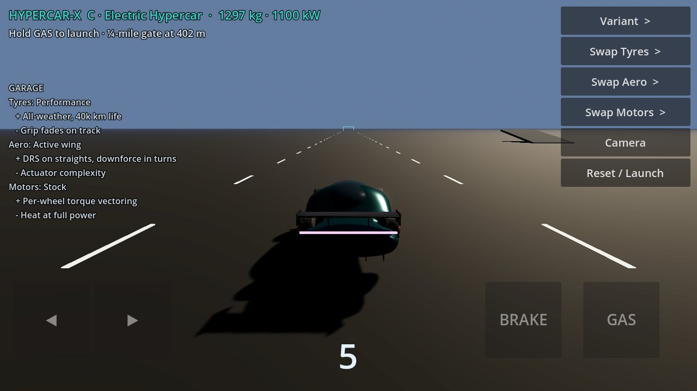

Godot 4.3 project using the Blender-baked GLB with `VehicleBody3D` physics. Mass, power, torque, grip, drag and downforce come from the engineering model (`godot/variants.json`).
- Touch pads (GAS, BRAKE, steer) plus keyboard (WASD or arrows)
- Garage: cycle variants, tyres, aero and motors, with pros and cons on screen
- Drag strip with a ¼-mile gate, slalom, handling ring and jump ramp; tyre smoke; active wing
- Calibrated against the Python model. In-app: 0-60 in 2.47 s, ¼ mile in 8.35 s, top speed 343 km/h. Model: 2.10 s, 8.07 s, 343 km/h.
- `.github/workflows/build-apps.yml` exports the **APK** and a **Windows .exe** and publishes them as a GitHub Release

## Blender model, animation & texture baking (`blender/`)
- `HypercarX.blend`: lofted super-ellipse body, full rig (root → body pitch/roll/heave → suspension → steer → spin), active rear-wing pivot, 300-frame launch/brake/turn animation with a tracking depth-of-field camera, studio cyclorama scene
- Procedural materials: pearl flake clear-coat paint, 2×2 twill carbon, chevron-tread tyre, brushed anisotropic alloy, drilled carbon-ceramic discs, emissive lights, asphalt
- Cycles GPU bake → `blender/textures/` (diffuse, roughness and normal maps for paint, carbon, tyre, rim and disc: 15 maps)
- Baked materials exported to `docs/hypercar_x.glb` for the web simulator and the Godot app
- Gallery: 11 Cycles renders (studio, road, detail, exploded, clay, night) and a 360° turntable in `docs/gallery/`

## Five variants from one platform
| Metric | A Urban Performance | B Track Hypercar | C Electric Hypercar | D Off-Road Adventure | E Autonomous Future Edition (2035) |
|---|---|---|---|---|---|
| Mass (kg) | 1294 | 1139 | 1297 | 1520 | 1344 |
| CG height (m) | 0.394 | 0.360 | 0.347 | 0.515 | 0.376 |
| Front weight (%) | 51.7 | 48.5 | 49.1 | 51.3 | 51.0 |
| Power (kW) | 450 | 1250 | 1100 | 620 | 800 |
| 0-60 mph (s) | 2.74 | 1.77 | 2.10 | 3.08 | 2.28 |
| 0-100 mph (s) | 4.96 | 2.76 | 3.41 | 5.25 | 3.75 |
| Quarter mile (s) | 9.93 | 7.35 | 8.07 | 10.12 | 8.65 |
| Top speed (km/h) | 328 | 343 | 343 | 355 | 343 |
| 60-0 mph (m) | 36.3 | 22.9 | 27.6 | 40.0 | 30.1 |
| 100-0 mph (m) | 98.4 | 56.0 | 72.4 | 108.3 | 80.3 |
| Lateral g @250 km/h | 1.12 | 3.20 | 1.86 | 0.95 | 1.57 |
| Downforce @250 km/h (N) | 851 | 11910 | 4821 | 0 | 3403 |
| Range @100 km/h (km) | 624 | 392 | 757 | 509 | 1055 |
| Ride frequency (Hz) | 1.80 | 3.01 | 2.33 | 1.42 | 2.29 |
| Chassis FoS (3 g bump) | 132 | 153 | 132 | 135 | 127 |
| Est. BOM cost (USD) | 156,000 | 244,000 | 243,000 | 175,000 | 282,000 |


## What's modelled
| Subsystem | Method |
|---|---|
| Mass & CG | 11-component build-up from parameters (CFRP tub area × thickness, pack kWh ÷ specific energy, …) |
| Aero | Drag = ½ρv²CdA, downforce = ½ρv²ClA |
| Launch | Time-stepped point mass, torque/power limited, traction limited incl. aero load |
| Braking | Numerical integration with aero assist; disc temperature rise from kinetic energy minus regen |
| Suspension | Quarter-car wheel rate, ride & wheel-hop frequency, critical damping, roll gradient |
| Steering | Ackermann inner/outer angles and turn radius |
| Chassis FEA | Euler–Bernoulli beam stiffness-matrix FEA (40 elements) of tub box section, 3 g bump; validated against 5wL⁴/384EI; Bredt–Batho torsional stiffness |
| Reliability | Series-system constant failure rates → MTBF |
| Simulator | Three.js, same parameters; bicycle model with saturating tyres, friction circle, aero drag/downforce, ¼-mile timing |

## Run
```bash
pip install -r requirements.txt
python -m hypercar.model C      # full JSON for one variant
python -m hypercar.report       # all variants → reports/
pytest -q
```
Change any value in `params.json` and rerun — every output and the simulator data update. CI (`.github/workflows/simulate.yml`) reruns tests and simulations on every push.

## Honest limits
First-order engineering estimates for a concept study, not validated CFD/crash/FEA. The chassis FoS is a single bending load case and is deliberately optimistic; real tub design is driven by torsion, crash and joint loads.
