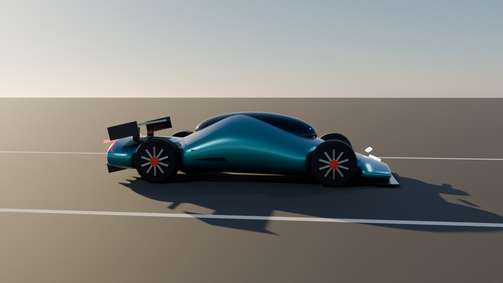
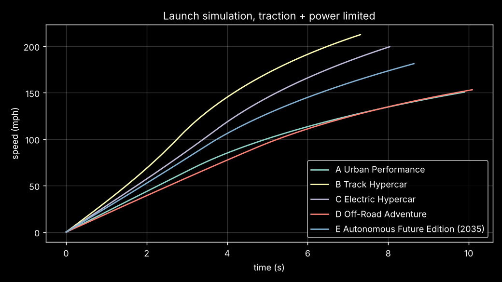
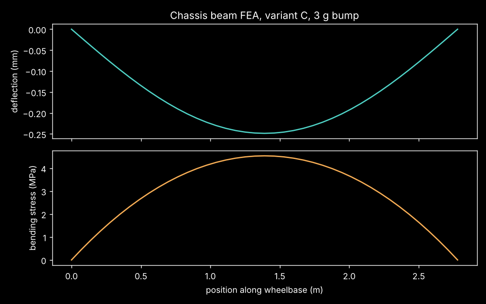

# 🏎️ HYPERCAR-X — Parametric Electric Hypercar Engineering Platform

A concept-level vehicle engineering package where **one master parameter table (`params.json`) drives everything**: mass and CG, aerodynamics, launch and braking simulation, suspension tuning, steering geometry, chassis FEA, range, reliability, cost, and a **drivable 3D simulator**.

**▶ Drive it:** `docs/index.html` · **▶ Presentation:** `docs/presentation.html` · **🎬 Animation:** `media/hypercar_x_drive.mp4`
(enable GitHub Pages → branch `main`, folder `/docs` to get live links)



## Blender model, animation & texture baking
- `blender/HypercarX.blend`: lofted super-ellipse body, full rig (root → body pitch/roll/heave → suspension → steer → spin), active rear wing pivot, 300-frame launch/brake/turn animation with tracking DoF camera
- Procedural materials: pearl flake clear-coat paint, 2×2 twill carbon, chevron-tread tyre, brushed anisotropic alloy, drilled carbon-ceramic discs, emissive lights, asphalt
- Cycles GPU bake → `blender/textures/` (diffuse, roughness, normal for paint, carbon, tyre, rim, disc: 15 maps)
- Baked materials exported to `docs/hypercar_x.glb`, viewable in the simulator ("Blender model" button)

## Garage: swappable parts with pros & cons
Wheels, tyres, aero, motors, battery and brakes can each be swapped live in the simulator, with an animated jack-up swap and an instant stat delta. Each option lists its pros and cons; see the presentation for the full trade-off table.

## Five variants from one platform
| Metric | A Urban Performance | B Track Hypercar | C Electric Hypercar | D Off-Road Adventure | E Autonomous Future Edition (2035) |
|---|---|---|---|---|---|
| Mass (kg) | 1294 | 1139 | 1297 | 1520 | 1344 |
| CG height (m) | 0.394 | 0.360 | 0.347 | 0.515 | 0.376 |
| Front weight (%) | 51.7 | 48.5 | 49.1 | 51.3 | 51.0 |
| Power (kW) | 450 | 1250 | 1100 | 620 | 800 |
| 0-60 mph (s) | 2.74 | 1.77 | 2.10 | 3.08 | 2.28 |
| 0-100 mph (s) | 4.96 | 2.76 | 3.41 | 5.25 | 3.75 |
| Quarter mile (s) | 9.93 | 7.35 | 8.07 | 10.12 | 8.65 |
| Top speed (km/h) | 328 | 343 | 343 | 355 | 343 |
| 60-0 mph (m) | 36.3 | 22.9 | 27.6 | 40.0 | 30.1 |
| 100-0 mph (m) | 98.4 | 56.0 | 72.4 | 108.3 | 80.3 |
| Lateral g @250 km/h | 1.12 | 3.20 | 1.86 | 0.95 | 1.57 |
| Downforce @250 km/h (N) | 851 | 11910 | 4821 | 0 | 3403 |
| Range @100 km/h (km) | 624 | 392 | 757 | 509 | 1055 |
| Ride frequency (Hz) | 1.80 | 3.01 | 2.33 | 1.42 | 2.29 |
| Chassis FoS (3 g bump) | 132 | 153 | 132 | 135 | 127 |
| Est. BOM cost (USD) | 156,000 | 244,000 | 243,000 | 175,000 | 282,000 |




## What's modelled
| Subsystem | Method |
|---|---|
| Mass & CG | 11-component build-up from parameters (CFRP tub area × thickness, pack kWh ÷ specific energy, …) |
| Aero | Drag = ½ρv²CdA, downforce = ½ρv²ClA |
| Launch | Time-stepped point mass, torque/power limited, traction limited incl. aero load |
| Braking | Numerical integration with aero assist; disc temperature rise from kinetic energy minus regen |
| Suspension | Quarter-car wheel rate, ride & wheel-hop frequency, critical damping, roll gradient |
| Steering | Ackermann inner/outer angles and turn radius |
| Chassis FEA | Euler–Bernoulli beam stiffness-matrix FEA (40 elements) of tub box section, 3 g bump; validated against 5wL⁴/384EI; Bredt–Batho torsional stiffness |
| Reliability | Series-system constant failure rates → MTBF |
| Simulator | Three.js, same parameters; bicycle model with saturating tyres, friction circle, aero drag/downforce, ¼-mile timing |

## Run
```bash
pip install -r requirements.txt
python -m hypercar.model C      # full JSON for one variant
python -m hypercar.report       # all variants → reports/
pytest -q
```
Change any value in `params.json` and rerun — every output and the simulator data update. CI (`.github/workflows/simulate.yml`) reruns tests and simulations on every push.

## Honest limits
First-order engineering estimates for a concept study, not validated CFD/crash/FEA. The chassis FoS is a single bending load case and is deliberately optimistic; real tub design is driven by torsion, crash and joint loads.
